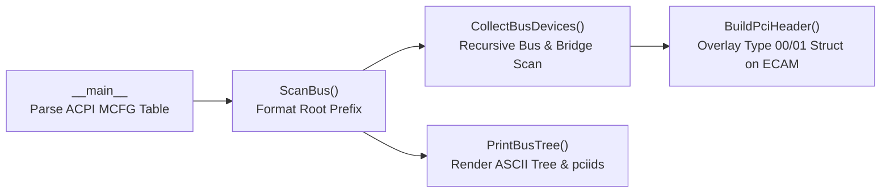

# Code Walkthrough: Building a Linux `lspci -vt` Style PCI Topology Viewer with EfiPy2 (`PciTree.py`)
# 程式碼解析：如何使用 EfiPy2 編寫 `PciTree.py` 繪製 PCIe 樹狀拓樸

`PciTree.py` is a UEFI Shell Python script built on **EfiPy2** that enumerates the PCI/PCIe hierarchy via **ECAM (Enhanced Configuration Access Mechanism)** MMIO and displays it in an enhanced Linux `lspci -vt` tree format—complete with Segment/Bus ranges (`-[Segment:StartBus-EndBus]-`), full `B:D.F` device addresses, Bridge secondary-to-subordinate bus ranges (`-[Sec-Sub]--`), and human-readable Vendor/Device names from `pciids`.

`PciTree.py` 是一支運行於 UEFI Shell 環境下的 **EfiPy2** 腳本。它透過 **ACPI `MCFG` 表**與 **ECAM (Enhanced Configuration Access Mechanism)** 記憶體映射機制，直接存取 PCIe 配置空間（Configuration Space），並將系統上所有的 Host Bridge、PCI-to-PCI Bridge（Root Port / Switch）與末端裝置（Endpoint），以類似 Linux `lspci -vt` 的樹狀結構搭配 `pciids` 可讀裝置名稱完整呈現出來。

Below, we walk through the implementation of `PciTree.py` function by function, explaining both the underlying PCIe/ACPI specifications and how EfiPy2 simplifies low-level hardware access in Python.

以下我們依照 `PciTree.py` 的程式結構，一步步解析每個函式的底層 PCIe/ACPI 規範原理與 EfiPy2 實作細節。

---

## 1. Execution Flow Overview (整體執行流程)



The script's workflow is divided into four core stages:
整支程式的運作邏輯分為四個核心階段：

1. **Parse the ACPI `MCFG` Table (`__main__`)**: Retrieve the ECAM MMIO base address (`BaseAddress`), the PCI Segment Group number (`PciSegmentGroupNumber`), and the decoded bus range (`StartBusNumber` to `EndBusNumber`).
   **解析 ACPI `MCFG` 表（`__main__`）**：取得 ECAM MMIO 基址（`BaseAddress`）、`PciSegmentGroupNumber` 以及 `StartBusNumber` ~ `EndBusNumber`。
2. **Dynamically Overlay PCI Headers (`BuildPciHeader`)**: Inspect the common header to determine whether a function is an Endpoint (Type 00) or a Bridge (Type 01), then overlay the corresponding EDK2 `Structure` directly onto the ECAM MMIO address.
   **動態映射 PCI Header（`BuildPciHeader`）**：根據裝置是 Endpoint（Type 00）還是 Bridge（Type 01），動態建立對應的 EDK2 `Structure` 並直接映射（Overlay）到 ECAM 記憶體位址。
3. **Recursively Collect Bus Topology (`CollectBusDevices` & `GetDeviceDesc`)**: Scan all Devices and Functions on a given Bus, resolve human-readable names via `pciids`, and recursively follow `SecondaryBus` whenever a PCI-to-PCI Bridge is encountered.
   **遞迴收集 Bus 拓樸（`CollectBusDevices` & `GetDeviceDesc`）**：掃描指定 Bus 上的所有 Device/Function，查詢 `pciids` 名稱；若遇到 PCI-to-PCI Bridge，則順著 `SecondaryBus` 遞迴向下掃描。
4. **Render the ASCII Tree (`PrintBusTree`)**: Calculate indentation, branch connectors (`+-`, `\-`, `|`), and bus range tags to print a clean hierarchical tree.
   **格式化輸出樹狀圖（`PrintBusTree`）**：根據收集到的裝置樹，自動計算縮排、連接線（`+-`、`\-`、`|`）與匯流排範圍標籤並印出結果。

---

## 2. Entry Point: Parsing the ACPI `MCFG` Table (`__main__`)
## 程式進入點：解析 ACPI `MCFG` 取得 ECAM 資訊

```python
if __name__ == '__main__':

  AcpiRaw    = ExtractTable (b'MCFG', 0)
  AcpiObj, _ = AcpiMcfgParser (AcpiRaw)
  PciCfgBase = AcpiObj.McfgDesc.BaseAddress
  PciSegment = AcpiObj.McfgDesc.PciSegmentGroupNumber
  StartBus   = AcpiObj.McfgDesc.StartBusNumber
  EndBus     = AcpiObj.McfgDesc.EndBusNumber

  ScanBus (StartBus, EndBus, PciSegment)
```

In modern PCIe systems, the 4 KB configuration space of every PCI function is linearly mapped into physical memory (MMIO) via **ECAM**. To discover where this MMIO region resides, firmware and operating systems consult the **ACPI `MCFG` (Memory Mapped Configuration Space Access)** table:

在現代 PCIe 系統中，每個 PCI Function 的 4 KB 配置空間都被線性映射到一段連續的實體記憶體（MMIO）中，稱為 **ECAM**。為了得知這段記憶體的實體位址，韌體與作業系統會查詢 ACPI 的 **`MCFG` (Memory Mapped Configuration Space Access)** 表：

- **`ExtractTable(b'MCFG', 0)`**:
  Extracts the raw binary payload of the first `MCFG` table from the UEFI System Table's ACPI Configuration Tables.
  從 UEFI System Table 的 ACPI Configuration Table 中取出原始的 `MCFG` 二進位資料。
- **`AcpiMcfgParser(AcpiRaw)`**:
  Casts the raw bytes into EfiPy2's `EFIPY_ACPI_MEMORY_MAPPED_CONFIGURATION_SPACE_ACCESS_DESCRIPTION_TABLE` structure.
  將二進位資料轉型為 EfiPy2 定義的 `EFIPY_ACPI_MEMORY_MAPPED_CONFIGURATION_SPACE_ACCESS_DESCRIPTION_TABLE` 結構體。
- **`AcpiObj.McfgDesc`**:
  Corresponds to `EFI_ACPI_MEMORY_MAPPED_ENHANCED_CONFIGURATION_SPACE_BASE_ADDRESS_ALLOCATION_STRUCTURE` defined in the PCI Firmware Specification, providing four essential fields:
  對應 PCI Firmware Specification 中的 `EFI_ACPI_MEMORY_MAPPED_ENHANCED_CONFIGURATION_SPACE_BASE_ADDRESS_ALLOCATION_STRUCTURE`，直接提供四個關鍵欄位：
  - `BaseAddress`: The physical starting address of the ECAM MMIO region (stored in the global `PciCfgBase`).
    ECAM MMIO 的起始實體位址（存入全域變數 `PciCfgBase`）。
  - `PciSegmentGroupNumber`: The 16-bit PCI Segment / Domain number (e.g., `0x0000`).
    16-bit 的 PCI Segment / Domain 編號（例如 `0x0000`）。
  - `StartBusNumber` / `EndBusNumber`: The starting and ending Bus numbers decoded by this ECAM allocation (e.g., `0x00` to `0xFF`).
    此 Segment 管理的起始與結束 Bus 編號（例如 `0x00` ~ `0xFF`）。

---

## 3. Mapping ECAM Memory to EDK2 Structures (`BuildPciHeader`)
## 動態建立與映射 PCI Configuration Header

```python
def BuildPciHeader (EcamBase: int, EcamOffset: int) -> None:

  PciCfgAddress = EcamBase + EcamOffset

  PciCfg = pci.PCI_TYPE00.from_address (PciCfgAddress)

  PciTypeFields = [
      ('Hdr',     pci.PCI_DEVICE_INDEPENDENT_REGION),
    ]

  #
  # Build TYPE 00/01 header
  #
  if pci.IS_PCI_BRIDGE (PciCfg) or pci.IS_CARDBUS_BRIDGE (PciCfg):
    # Type 1
    PciTypeFields.append (('Cfg', pci.PCI_BRIDGE_CONTROL_REGISTER))

  else:
    # Type 0
    PciTypeFields.append (('Cfg', pci.PCI_DEVICE_HEADER_TYPE_REGION))

  class PciStruct (EFIPY_INDUSTRY_STRUCTURE):
    _fields_ = PciTypeFields

  PciCfg = PciStruct.from_address (PciCfgAddress)

  return PciCfg, PciStruct
```

`BuildPciHeader` showcases one of **EfiPy2**'s most powerful capabilities: overlaying EDK2 C structures from `MdePkg.IndustryStandard.Pci` directly onto physical MMIO addresses via `.from_address(PciCfgAddress)`.

`BuildPciHeader` 展示了 **EfiPy2** 最核心的優勢：直接將 EDK2 `MdePkg.IndustryStandard.Pci` 的 C 結構體映射到硬體 MMIO 位址上（`.from_address(PciCfgAddress)`）：

1. **Reading the Common Header (`PCI_DEVICE_INDEPENDENT_REGION`)**:
   Every PCI function shares the exact same 16-byte layout at offsets `0x00` to `0x0F`, containing `VendorId`, `DeviceId`, `Command`, `Status`, `RevisionID`, `ClassCode[3]`, and `HeaderType`.
   **讀取共用標頭（`PCI_DEVICE_INDEPENDENT_REGION`）**：所有 PCI 裝置的前 16 bytes（Offset `0x00` ~ `0x0F`）格式完全固定，包含 `VendorId`、`DeviceId`、`Command`、`Status`、`RevisionID`、`ClassCode[3]` 與 `HeaderType`。
2. **Distinguishing Header Types (Type 00 vs. Type 01)**:
   - Using the EDK2 helper macro `pci.IS_PCI_BRIDGE(PciCfg)`, the script checks whether `(PciCfg.Hdr.HeaderType & 0x7F) == 0x01`.
   - If the function is a **Type 01 (PCI-to-PCI Bridge)**, offsets `0x10` to `0x3F` are mapped as `pci.PCI_BRIDGE_CONTROL_REGISTER`, which exposes `PrimaryBus`, `SecondaryBus`, and `SubordinateBus`.
   - Otherwise, for a **Type 00 (Endpoint Device)**, offsets `0x10` to `0x3F` are mapped as `pci.PCI_DEVICE_HEADER_TYPE_REGION`.
   **判斷 Header Type（Type 00 vs. Type 01）**：
   - 透過 EDK2 巨集函式 `pci.IS_PCI_BRIDGE(PciCfg)` 檢查 `(PciCfg.Hdr.HeaderType & 0x7F) == 0x01`。
   - 如果是 **Type 01 (PCI-to-PCI Bridge)**，Offset `0x10` ~ `0x3F` 會掛載 `pci.PCI_BRIDGE_CONTROL_REGISTER`（內含建立樹狀圖所需的 `PrimaryBus`、`SecondaryBus` 與 `SubordinateBus`）。
   - 如果是 **Type 00 (一般 Endpoint 裝置)**，則掛載 `pci.PCI_DEVICE_HEADER_TYPE_REGION`。
3. **Zero-Copy Register Access**:
   By calling `PciStruct.from_address(PciCfgAddress)`, any subsequent attribute access like `PciCfg.Hdr.VendorId` or `PciCfg.Cfg.SecondaryBus` reads directly from the memory-mapped hardware register without manual bit-shifting or buffer copying.
   **Zero-Copy 暫存器存取**：最後透過 `PciStruct.from_address(PciCfgAddress)` 回傳映射物件 `PciCfg`。後續存取 `PciCfg.Hdr.VendorId` 或 `PciCfg.Cfg.SecondaryBus` 時，底層會直接從 ECAM MMIO 位址取值，不需手動複製記憶體或做位移運算。

---

## 4. Resolving Vendor and Device Names (`GetDeviceDesc`)
## 透過 `pciids` 轉換可讀的廠商與裝置名稱

```python
def GetDeviceDesc (VendorId: int, DeviceId: int) -> str:
  VendorName, DeviceDict = pciids.PciIds.get (VendorId, (f"Vendor {VendorId:04x}", {}))
  DeviceName, _          = DeviceDict.get (DeviceId, (f"Device {DeviceId:04x}", {}))
  return f"{VendorName} {DeviceName} [{VendorId:04x}:{DeviceId:04x}]"
```

To combine human-readable device names (like `lspci -v`) with raw hexadecimal IDs (like `lspci -nn`), `GetDeviceDesc` queries the `pciids.PciIds` dictionary:

為了讓輸出的樹狀圖同時具備人類可讀的裝置名稱（如 `lspci -v`）與十六進位識別碼（如 `lspci -nn`），`GetDeviceDesc` 會查詢 `pciids.PciIds` 字典：

- **First-level lookup (`VendorId`)**: Retrieves `(VendorName, DeviceDict)` from `pciids.PciIds`, falling back to `Vendor xxxx` if the vendor ID is unknown.
  **第一層查詢（`VendorId`）**：以 `VendorId` 為 key 取出 `(VendorName, DeviceDict)`；若資料庫中無此廠商，則預設顯示 `Vendor xxxx`。
- **Second-level lookup (`DeviceId`)**: Retrieves `DeviceName` from `DeviceDict`, falling back to `Device xxxx` if the device ID is not listed.
  **第二層查詢（`DeviceId`）**：在 `DeviceDict` 中以 `DeviceId` 為 key 取出 `DeviceName`；若找不到則預設顯示 `Device xxxx`。
- **Formatted Output**: Combines both names and the `[vid:did]` tag into `{VendorName} {DeviceName} [{VendorId:04x}:{DeviceId:04x}]` (for example, `Red Hat, Inc. QEMU PCIe Root port [1b36:000c]`).
  **格式化輸出**：最後組合成 `{VendorName} {DeviceName} [{VendorId:04x}:{DeviceId:04x}]`（例如：`Red Hat, Inc. QEMU PCIe Root port [1b36:000c]`）。

---

## 5. Recursive Bus & Bridge Discovery (`CollectBusDevices`)
## 遞迴收集匯流排與 Bridge 子樹

```python
def CollectBusDevices (Bus: int) -> list:
  devices = []

  for Dev in range (pci.PCI_MAX_DEVICE + 1):
    for Func in range (pci.PCI_MAX_FUNC + 1):

      PciCfgOffset = pci.PCI_ECAM_ADDRESS (Bus, Dev, Func, 0)
      PciObj, _    = BuildPciHeader (PciCfgBase, PciCfgOffset)

      VendorId = PciObj.Hdr.VendorId
      if VendorId in (0xFFFF, 0x0000) and Func == 0:
        break

      if VendorId in (0xFFFF, 0x0000):
        continue

      DeviceId = PciObj.Hdr.DeviceId
      IsMulti  = pci.IS_PCI_MULTI_FUNC (PciObj)
      IsBridge = pci.IS_PCI_BRIDGE (PciObj) or pci.IS_PCI_P2P (PciObj)

      dev_entry = {
        "bus":      Bus,
        "dev":      Dev,
        "func":     Func,
        "vid":      VendorId,
        "did":      DeviceId,
        "desc":     GetDeviceDesc (VendorId, DeviceId),
        "is_bridge": IsBridge,
        "sec_bus":  PciObj.Cfg.SecondaryBus if IsBridge else 0,
        "sub_bus":  PciObj.Cfg.SubordinateBus if IsBridge else 0,
        "children": [],
      }

      if IsBridge and dev_entry["sec_bus"] > Bus:
        dev_entry["children"] = CollectBusDevices (dev_entry["sec_bus"])

      devices.append (dev_entry)

      if Func == 0 and not IsMulti:
        break

  return devices
```

`CollectBusDevices` iterates through all 32 Devices (`0..31`) and 8 Functions (`0..7`) on a given `Bus` to build a hierarchical list of device nodes:

`CollectBusDevices` 負責走訪單一 `Bus` 上的所有 Device（`0..31`）與 Function（`0..7`），並建構出樹狀資料結構：

1. **Calculating the ECAM Offset (`pci.PCI_ECAM_ADDRESS`)**:
   Uses the EDK2 macro to compute the byte offset in ECAM MMIO: `((Bus << 20) | (Dev << 15) | (Func << 12) | Reg)`.
   **計算 ECAM Offset（`pci.PCI_ECAM_ADDRESS`）**：使用 EDK2 標準巨集將 `(Bus, Dev, Func, Reg)` 轉換為 ECAM 的記憶體位移量：`((Bus << 20) | (Dev << 15) | (Func << 12) | Reg)`。
2. **Checking Device Presence (`VendorId`)**:
   - When an unpopulated slot is read, the host bridge returns all ones (`0xFFFF`). If `Func == 0` returns `0xFFFF` (or `0x0000`), no device is present at this `Dev` number, so we `break` out of the `Func` loop immediately.
   - If `Func > 0` returns `0xFFFF`, that specific function is unpopulated on a multi-function device, so we `continue` to the next `Func`.
   **檢查裝置是否存在（`VendorId`）**：
   - 當讀取空插槽時，Host Bridge 會回傳 `0xFFFF`。若 `Func == 0` 讀出 `0xFFFF`（或 `0x0000`），代表該 `Dev` 沒有裝置，直接 `break` 跳過其餘 Function。
   - 若在 `Func > 0` 讀到 `0xFFFF`，代表多功能裝置的該 Function 未實作，則 `continue` 檢查下一個 Function。
3. **Recursive Traversal Across Bridges**:
   - If `IsBridge` is `True` (`pci.IS_PCI_BRIDGE(PciObj)` or `pci.IS_PCI_P2P(PciObj)`), the script reads `SecondaryBus` (the bus immediately downstream of the bridge) and `SubordinateBus` (the highest bus number behind the bridge subtree).
   - When `sec_bus > Bus`, it recursively calls `CollectBusDevices(dev_entry["sec_bus"])` and attaches the returned list to `dev_entry["children"]`.
   **遞迴深入 PCI-to-PCI Bridge**：
   - 若 `IsBridge` 為 `True`，則從 Type 01 Header 的 `PciObj.Cfg` 讀出 `SecondaryBus`（Bridge 下游緊鄰的 Bus 號）與 `SubordinateBus`（該 Bridge 子樹下最大的 Bus 號）。
   - 當 `sec_bus > Bus` 時，遞迴呼叫 `CollectBusDevices(dev_entry["sec_bus"])`，將下游 Bus 的所有裝置存入 `dev_entry["children"]`。
4. **Multi-Function Check (`pci.IS_PCI_MULTI_FUNC`)**:
   - `if Func == 0 and not IsMulti: break` checks Bit 7 (`0x80`) of `HeaderType` on Function 0.
   - Single-function devices often ignore the Function number bits during configuration cycles; if we do not stop after `Func == 0`, the same device could be duplicated across `Func 1..7`.
   **Multi-Function 檢查（`pci.IS_PCI_MULTI_FUNC`）**：
   - `if Func == 0 and not IsMulti: break` 會檢查 `Func 0` 的 `HeaderType` Bit 7 (`0x80`)。
   - 單一功能裝置（Single-Function Device）通常不會解碼 `Func 1..7`；若不在此 `break`，`Func 1..7` 可能會重複映射出與 `Func 0` 相同的內容。

---

## 6. Rendering the Tree View (`PrintBusTree` & `ScanBus`)
## 繪製樹狀結構與對齊排版

Why do we collect the entire bus list in `CollectBusDevices` before printing in `PrintBusTree`?
Because drawing an accurate ASCII tree requires knowing **whether the current node is the last device on its bus (`is_last = (idx == total - 1)`)**:
- **If it is NOT the last device (`not is_last`)**: Its branch connector is `+-`, and any child lines printed below it must preserve a vertical continuation bar `| ` in the current bus's column to connect to subsequent sibling devices.
- **If it IS the last device (`is_last`)**: Its branch connector is `\-`, and its child lines use blank spaces `  ` in the current bus's column.

為什麼要先在 `CollectBusDevices` 把整條 Bus 的裝置收集完，再交給 `PrintBusTree` 印出？
因為在繪製 ASCII 樹狀圖時，**必須預先知道目前節點是不是該條 Bus 上的最後一個裝置（`is_last = (idx == total - 1)`）**：
- **若不是最後一個裝置（`not is_last`）**：分支符號用 `+-`，且在展開它的子樹時，左方必須保留垂直延續線 `| `，以連接同層級後面的兄弟裝置。
- **若是最後一個裝置（`is_last`）**：分支符號用 `\-`，且展開子樹時左方留白 `  `，不再畫垂直線。

```python
def PrintBusTree (devices: list, line_prefix: str, cont_prefix: str, is_root: bool = False) -> None:
  if not devices:
    if is_root:
      print (line_prefix)
    return

  total = len (devices)
  for idx, dev in enumerate (devices):
    is_first = (idx == 0)
    is_last  = (idx == total - 1)

    conn = "\\-" if is_last else "+-"

    dev_line_prefix = (line_prefix if (is_first and is_root) else cont_prefix) + conn
    branch_bar      = "  " if is_last else "| "
    dev_cont_prefix = cont_prefix + branch_bar

    bdf_str = f"{dev['bus']:02x}:{dev['dev']:02x}.{dev['func']:x}"

    if dev["is_bridge"]:
      sec = dev["sec_bus"]
      sub = dev["sub_bus"]
      bus_tag = f"-[{sec:02x}-{sub:02x}]--"

      print (f"{dev_line_prefix}{bdf_str}{bus_tag}  {dev['desc']}")

      if dev["children"]:
        child_cont_prefix = dev_cont_prefix + " " * (len (bdf_str) + len (bus_tag))
        PrintBusTree (dev["children"], child_cont_prefix, child_cont_prefix, is_root=False)
    else:
      print (f"{dev_line_prefix}{bdf_str}  {dev['desc']}")

def ScanBus (StartBus: int = 0, EndBus: int = 0xFF, Segment: int = 0) -> None:
  root_prefix = f"-[{Segment:04x}:{StartBus:02x}-{EndBus:02x}]-"
  root_cont   = " " * len (root_prefix)
  devices     = CollectBusDevices (StartBus)
  PrintBusTree (devices, root_prefix, root_cont, is_root=True)
```

### Formatting Highlights (排版設計重點)
1. **Root Prefix (`-[Segment:StartBus-EndBus]-`)**:
   In `ScanBus`, `root_prefix` is formatted as `-[0000:00-ff]-`. The very first device on the Root Bus is printed on the same line immediately after `root_prefix` (`is_first and is_root`), while all subsequent devices start on a new line aligned with `root_cont = " " * len(root_prefix)`.
   **根節點前綴（`-[Segment:StartBus-EndBus]-`）**：在 `ScanBus` 中，`root_prefix` 格式為 `-[0000:00-ff]-`。Root Bus 的第一個裝置會直接印在同一行後方（`is_first and is_root`），而第二個以後的裝置則換行並以等長空白 `root_cont = " " * len(root_prefix)` 對齊。
2. **Full `B:D.F` & Bridge Bus Range (`-[sec-sub]--`)**:
   Every node prints its complete `B:D.F` (`bdf_str = f"{dev['bus']:02x}:{dev['dev']:02x}.{dev['func']:x}"`). If the node is a Bridge, it appends `bus_tag = f"-[{sec:02x}-{sub:02x}]--"` and prints the Bridge's own vendor/device description on that line—unlike standard Linux `lspci -vt`, which hides the Bridge's name when child devices are present.
   **完整 `B:D.F` 與 Bridge 次級匯流排範圍（`-[sec-sub]--`）**：每個節點皆顯示完整的 `B:D.F`（如 `00:02.0`）。當節點為 Bridge 時，後方會緊接印出它管理的次級匯流排範圍 `-[{sec:02x}-{sub:02x}]--`（如 `-[01-01]--`）以及 Bridge 本身的裝置名稱，解決了標準 Linux `lspci -vt` 在有子裝置時會省略 Bridge 名稱的問題。
3. **Automatic Child Indentation**:
   When a Bridge has downstream devices (`if dev["children"]:`), `child_cont_prefix` appends `" " * (len(bdf_str) + len(bus_tag))` to `dev_cont_prefix`, ensuring the child branch connectors (`+-` / `\-`) align right after the parent Bridge's `-[sec-sub]--` tag.
   **子匯流排自動縮排對齊**：當 Bridge 下游有子裝置時（`if dev["children"]:`），下一層的縮排字串 `child_cont_prefix` 會自動加上 `len(bdf_str) + len(bus_tag)` 個空白字元，讓子裝置的 `+-` / `\-` 精準對齊在父層 Bridge 的 `-[sec-sub]--` 正後方。

---

## 7. Sample Output (實際執行輸出)

Running `python PciTree.py` in the UEFI Shell on a QEMU Q35 virtual machine produces the following output:

在 QEMU Q35 虛擬機的 UEFI Shell 中執行 `python PciTree.py`，輸出結果如下：

```text
FS0:\Efi\Apps\EfiPy2Sample\> python PciTree.py
-[0000:00-ff]-+-00:00.0  Intel Corporation 82G33/G31/P35/P31 Express DRAM Controller [8086:29c0]
              +-00:01.0  Red Hat, Inc. QXL paravirtual graphic card [1b36:0100]
              +-00:02.0-[01-01]--  Red Hat, Inc. QEMU PCIe Root port [1b36:000c]
              |                  \-01:00.0  Red Hat, Inc. Virtio 1.0 network device [1af4:1041]
              +-00:02.1-[02-02]--  Red Hat, Inc. QEMU PCIe Root port [1b36:000c]
              |                  \-02:00.0  Red Hat, Inc. QEMU XHCI Host Controller [1b36:000d]
              +-00:02.2-[03-03]--  Red Hat, Inc. QEMU PCIe Root port [1b36:000c]
              |                  \-03:00.0  Red Hat, Inc. Virtio 1.0 console [1af4:1043]
              +-00:02.3-[04-04]--  Red Hat, Inc. QEMU PCIe Root port [1b36:000c]
              |                  \-04:00.0  Red Hat, Inc. Virtio 1.0 SCSI [1af4:1048]
              +-00:02.4-[05-05]--  Red Hat, Inc. QEMU PCIe Root port [1b36:000c]
              |                  \-05:00.0  Red Hat, Inc. Virtio 1.0 balloon [1af4:1045]
              +-00:02.5-[06-06]--  Red Hat, Inc. QEMU PCIe Root port [1b36:000c]
              |                  \-06:00.0  Red Hat, Inc. Virtio 1.0 RNG [1af4:1044]
              +-00:02.6-[07-07]--  Red Hat, Inc. QEMU PCIe Root port [1b36:000c]
              +-00:02.7-[08-08]--  Red Hat, Inc. QEMU PCIe Root port [1b36:000c]
              +-00:1b.0  Intel Corporation 82801I (ICH9 Family) HD Audio Controller [8086:293e]
              +-00:1f.0  Intel Corporation 82801IB (ICH9) LPC Interface Controller [8086:2918]
              +-00:1f.2  Intel Corporation 82801IR/IO/IH (ICH9R/DO/DH) 6 port SATA Controller [AHCI mode] [8086:2922]
              \-00:1f.3  Intel Corporation 82801I (ICH9 Family) SMBus Controller [8086:2930]
```

From this output, we can immediately observe:
從上方輸出可以一目了然地看出：

- **Segment & Bus Range**: The system operates on PCI Segment `0000` with root bus range `00-ff`.
  **Segment 與匯流排範圍**：系統的 PCI Segment 為 `0000`，主匯流排範圍為 `00-ff`。
- **PCIe Root Ports (`00:02.0` to `00:02.7`)**: Eight multifunction QEMU PCIe Root Ports (`[1b36:000c]`) bridge Root Bus `00` to Secondary Buses `01` through `08`.
  **PCIe Root Ports（`00:02.0` ~ `00:02.7`）**：8 個多功能 QEMU PCIe Root Ports（`[1b36:000c]`）分別將 Bus `00` 橋接至次級匯流排 Bus `01` ~ `08`。
- **Downstream Endpoints vs. Empty Slots**: Buses `01` through `06` each host a downstream Virtio or XHCI Endpoint device (`01:00.0` to `06:00.0`), while Root Ports `00:02.6` (`[07-07]`) and `00:02.7` (`[08-08]`) are empty slots with no downstream devices attached.
  **下游裝置與空插槽**：Bus `01` ~ `06` 下游各自掛載了一個 Virtio 或 XHCI 裝置（`01:00.0` ~ `06:00.0`），而 `00:02.6`（`[07-07]`）與 `00:02.7`（`[08-08]`）則是尚未接上子裝置的空 Root Port。
